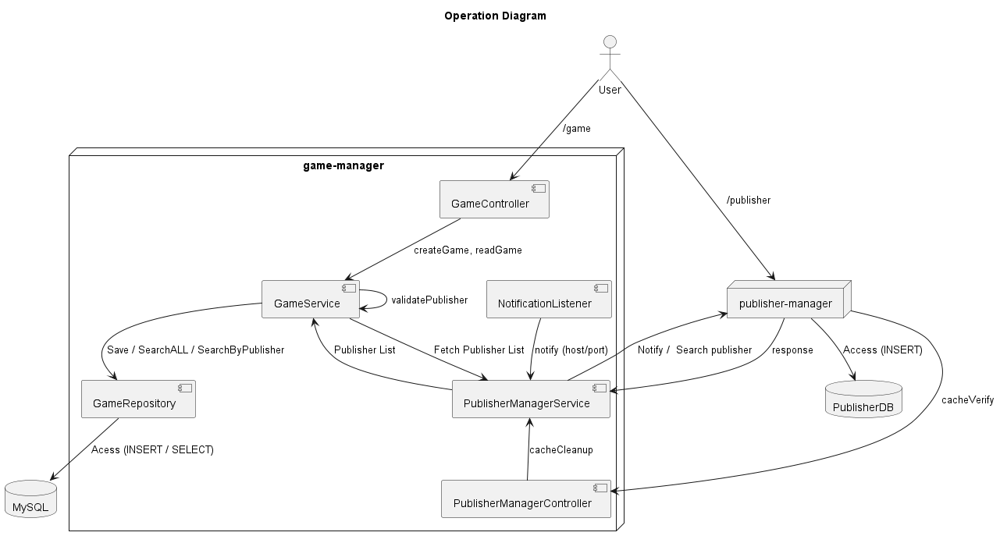
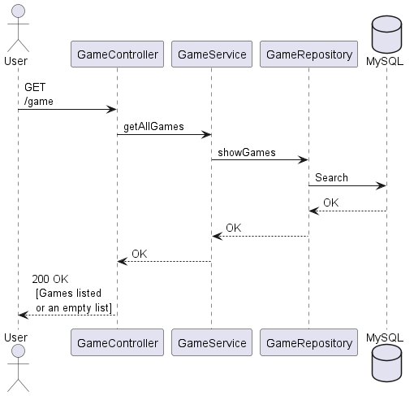
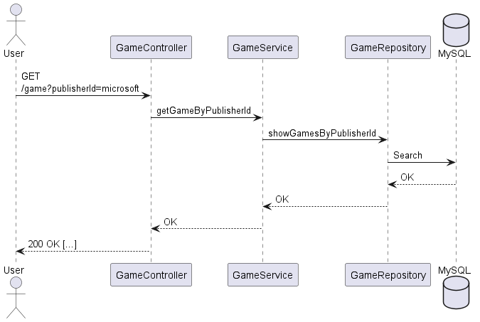
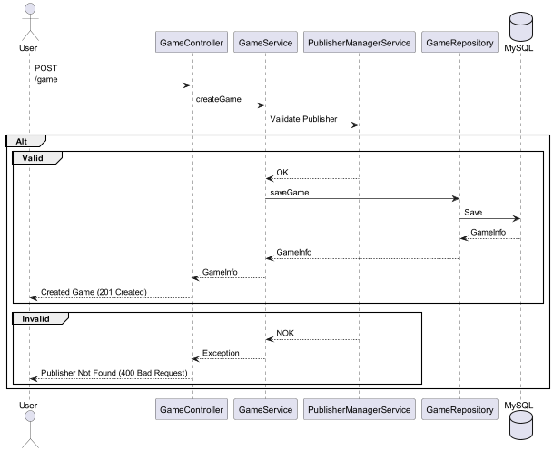

<h1 align="center"> Project 1 - IDP - Game Manager</h1>

You need to install the following technology:

<div align="left">


</div>

---

## About the Project

This is the first IDP project with closed scope. The project consists of a game manager,
in which the user can save and list games. The target audience for this project is all
users who like games and want to better manager their time played.

In this project I used the  [Mysql](https://hub.docker.com/_/mysql)
and [adautomendes/publisher-manager](https://hub.docker.com/r/adautomendes/publisher-manager) containers,
and some knowledge acquired in alura courses.
---

## Diagrams

1. The following operation diagram shows the macro vision of distribution of the microservices

<h1 align="center">
    
</h1> 
The user can perform three operations: 

- Read all games in database, following the next sequence diagram:

<h1 align="center">
    
</h1>

- Read only games specified by publisherId, following the next sequence diagram:

<h1 align="center">
    
</h1>

- Save a new game in database, following the next sequence diagram:

<h1 align="center">
    
</h1>

---

## Technologies

What I used to development the project:</p>

<div align="left">


</div>

---

## Project

<h3> Running the application:</h3>
Use the following command to clone the project:

```bash
$ https://github.com/LucasSResende/Project1_IDP.git
```

To build the project, use this command:

```bash
$ mvn clean install -DskipTests
```

Then enter the Ubuntu terminal, in the same directory where the pom file is present.
And start the application container with the following command:

```bash
$ docker-compose up --build
```

---

# End-Points

Endpoints of port 8081 (Game Manager)

To read all games:
`GET  http://localhost:8081/game`

To read games by publisherId:
`GET  http://localhost:8081/game?publisherId={publisherId}`

It is necessary to use a valid publisherId in the URL;

To register a new timePlayed with games:
`POST  http://localhost:8081/game`

-The input payload for creating a timePlayed with games needs to follow these example:

```bash
{
    "publisherId": "nintendo",
    "name": "Mario",
    "timePlayed":
        {
            "2023-05-01": 10,
            "2023-05-02": 2,
            "2023-05-03": 3,
            "2023-05-04": 4
        }
}
```

After save game, an output will be return following these example:

```bash
{
    "id": "004ce1bf-951d-4193-b9fe-6bfdbe58544a"
    "publisherId": "nintendo",
    "name": "Mario",
    "timePlayed":
        {
            "2023-05-01": 10,
            "2023-05-02": 2,
            "2023-05-03": 3,
            "2023-05-04": 4
        }
}
```

To clean cache:
`DELETE  http://localhost:8081/publishermanagercache`

To clean the cache of my application, an API call
is made automatically by the external API when a publisher is created.

Endpoints of port 8080 (Publisher Manager)

To read all publishers:
`GET  http://localhost:8080/publisher`

To register a new publisher:
`POST  http://localhost:8080/publisher`

The payload for creating a publisher follows the example:

```bash
{
  "id": "microsoft",
  "name": "Microsotf company"
}
```