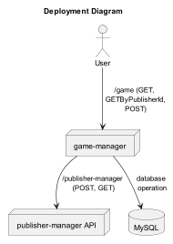

<h1 align="center"> Project 1 - IDP - Game Manager</h1>

<<<<<<< Updated upstream
=======
# PreRequisites: <!--Prerequisites-->

>>>>>>> Stashed changes
You need to install the following technology:

<div align="left">


</div>

---

## About the Project

This is the first IDP project with closed scope. The project consists of a game manager,
in which the user can save and list games. The target audience for this project is all
users who like games and want to better manager their time played.

In this project I used the  [Mysql](https://hub.docker.com/_/mysql)
and [adautomendes/publisher-manager](https://hub.docker.com/r/adautomendes/publisher-manager) containers,
<<<<<<< Updated upstream
and some knowledge acquired in alura courses.
=======
and some knowledge acquired in alura <!--through Alura--> courses:

- Git;
- API Rest;
- Spring boot;
- JPA persistence;
- Unit tests;
- Mock;
- Docker;
- And any other knowledge like algorithms and logical. <!--and programming logic-->

>>>>>>> Stashed changes
---

## Diagrams <!--What about a deployment or installation diagram-->

<<<<<<< Updated upstream
1. The following operation diagram shows the macro vision of distribution of the microservices
=======
1. The following operation diagram shows the macro vision of distribution working <!--working distribution--> of the microservices <!--You can remove this diagram and keep only the second one as they represent the same concept: operation-->

<h1 align="center">
    
</h1> 

- The following operation diagram shows a general vision of distribution of the microservices
>>>>>>> Stashed changes

<h1 align="center">
    
</h1> 
The user can perform three operations: 

- Read all games in database, following the next sequence diagram:

<h1 align="center">
    
</h1> <!--Is not there a failure scenario considered?-->

- Read only games specified by publisherId, following the next sequence diagram:

<h1 align="center">
    
</h1> <!--Is not there a failure scenario considered?-->

- Save a new game in database, following the next sequence diagram:

<h1 align="center">
    
</h1>

---

## Technologies <!--This section is better located after the introduction section-->

What I used to development the project:</p>

<div align="left">


</div>

---

<<<<<<< Updated upstream
## Project

<h3> Running the application:</h3>
Use the following command to clone the project:
=======
## Steps to run the Project <!--Place this section after the diagrams section-->

<h3> Running the application:</h3>
Use the following command to clone the project on terminal <!--a terminal. Also do you mean any OS? If so, replace this with OS--> of your choice in some folder to use:
>>>>>>> Stashed changes

```bash
$ https://github.com/LucasSResende/Project1_IDP.git
```

<<<<<<< Updated upstream
To build the project, use this command:
=======
To build the project, use this command on terminal <!--look the previous comment--> in the folder where the project was cloned:
>>>>>>> Stashed changes

```bash
$ mvn clean install -DskipTests
```

<<<<<<< Updated upstream
Then enter the Ubuntu terminal, in the same directory where the pom file is present.
=======
Then enter the terminal <!--what do you mean here? Rephrase this because it is confusing--> where working Docker <!--where Docker is working?-->, in the same directory where the pom file is present.
>>>>>>> Stashed changes
And start the application container with the following command:

```bash
$ docker-compose up --build
```

---

# End-Points <!--Endpoints-->

Endpoints of port 8081 (Game Manager)

To read all games:
`GET  http://localhost:8081/game`

To read games by publisherId:
`GET  http://localhost:8081/game?publisherId={publisherId}`

It is necessary to use a valid publisherId in the URL;

To register a new timePlayed with games:
`POST  http://localhost:8081/game`

-The input payload for creating a timePlayed with games needs to follow these example <!---the sctructure->:

```bash
{
    "publisherId": "nintendo",
    "name": "Mario",
    "timePlayed":
        {
            "2023-05-01": 10,
            "2023-05-02": 2,
            "2023-05-03": 3,
            "2023-05-04": 4
        }
}
```
<!--Describe the meaning of each field so that the user can understand better the type of data expected-->

<<<<<<< Updated upstream
After save game, an output will be return following these example:
=======
## Endpoint of Response <!--I do not agree with and endpoint for response. Maybe just output?-->

After save game <!--a game is saved-->, an output on platform used <!--on platform used? This is confusing--> will be return following these example <!--the structure-->:
>>>>>>> Stashed changes

```bash
{
    "id": "004ce1bf-951d-4193-b9fe-6bfdbe58544a"
    "publisherId": "nintendo",
    "name": "Mario",
    "timePlayed":
        {
            "2023-05-01": 10,
            "2023-05-02": 2,
            "2023-05-03": 3,
            "2023-05-04": 4
        }
}
```

To clean cache:
`DELETE  http://localhost:8081/publishermanagercache`

<<<<<<< Updated upstream
To clean the cache of my application, an API call
is made automatically by the external API when a publisher is created.

Endpoints of port 8080 (Publisher Manager)

To read all publishers:
`GET  http://localhost:8080/publisher`

To register a new publisher:
`POST  http://localhost:8080/publisher`

The payload for creating a publisher follows the example:

```bash
{
  "id": "microsoft",
  "name": "Microsotf company"
}
```
=======
To clean the cache of my <!--the--> application, an API call
is made automatically by the external API when a publisher is created.
>>>>>>> Stashed changes
